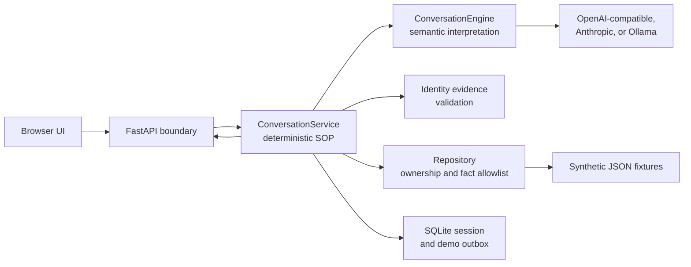

<!--
  Primary setup, architecture, safety, operation, and verification guide for the
  ClaimBot take-home project.
-->
# ClaimBot — Insurance Claims SOP Harness

ClaimBot is a text-based insurance support demo that combines a language model's
semantic interpretation with a deterministic business workflow:

```text
VERIFY_ID → RESOLVE_INTENT → PROCESS_CASE → POST_PROCESS → COMPLETE
```

The model interprets customer messages. Application code verifies identity,
checks claim ownership, controls phase transitions, selects grounded claim facts,
and authorizes the simulated email action. A small browser UI shows the current
phase and whether a reply used the model or safe recovery.

All included customers and claims are synthetic. Email delivery and human
transfer are simulated; neither contacts an external recipient.

## Hosted demo

Open **[ClaimBot on Render](https://claimbot-sop-harness.onrender.com/)** to test
the complete browser workflow. The service uses synthetic records, and the email
shown at the end is a preview only; no external message is delivered. A free
Render instance may need a short warm-up after it has been idle.

The hosted deployment is configured in **model mode** through a compatible
provider. The deterministic workflow remains responsible for verification,
claim ownership, phase transitions, grounding, and email consent. If the model
provider is unavailable, the application preserves state and returns safe
recovery instead of guessing through keyword routing.

Health endpoint:
[https://claimbot-sop-harness.onrender.com/api/health](https://claimbot-sop-harness.onrender.com/api/health)

## Do I need a paid API key?

No. The recommended no-credit setup uses **Ollama** and the included
`.env.ollama` configuration to run a model locally. It exercises the same
structured model interface and deterministic safety gates as a hosted provider.

ClaimBot supports three runtime options:

1. **Local Ollama:** full model-backed demo without cloud API credits. Follow
   [Local Ollama demo](#local-ollama-demo).
2. **Hosted model provider:** set an OpenAI-compatible or Anthropic API token.
   The workflow code does not change when the provider changes.
3. **No model configured:** the service still starts in limited rules mode for
   labeled inputs and deterministic workflow demonstrations. This mode is not a
   substitute for evaluating natural-language understanding.

## Quick start: Docker with an API token

Prerequisite: Docker with Docker Compose. Run these commands from this directory.

```sh
cp .env.example .env
```

Edit `.env` and set your provider credentials and model. For example, for an
OpenAI-compatible provider:

```dotenv
OPENAI_API_KEY=your-api-token
LLM_MODEL=your-model-name
# Set this only for a compatible third-party endpoint:
# LLM_BASE_URL=https://your-provider.example/v1
```

The endpoint must support chat completions with JSON-schema structured output.
`LLM_API_KEY` is an alternative to `OPENAI_API_KEY`. For Anthropic, set
`ANTHROPIC_API_KEY` and `LLM_MODEL`, leaving `LLM_BASE_URL` and the other keys
empty. Choose a model that supports structured output. Only configure one provider.

```sh
docker compose up --build -d
```

Open **[http://localhost:8000](http://localhost:8000)**. A successful build alone
does not start the service; `up` builds and starts it. The API health endpoint is
[http://localhost:8000/api/health](http://localhost:8000/api/health).

```sh
docker compose logs --tail=50 agent
docker compose stop
```

Without a provider token the application starts in **rules mode**, a limited
offline demonstration with labeled identity inputs. Use model mode to evaluate
natural-language understanding. A configured but failing model produces safe
recovery, rather than silently routing the message through the rules parser.

## Local Ollama demo

For Docker Desktop on macOS/Windows, install and start Ollama, then download the
model used by the included configuration:

```sh
ollama pull qwen2.5:3b
docker compose --env-file .env.ollama -p claimbot-lean-local up --build -d
```

Open **[http://localhost:8001](http://localhost:8001)**. `.env.ollama` uses
`host.docker.internal` to reach Ollama on the host and a non-secret placeholder
token. On Linux, use a reachable host address or configure Docker's host gateway
mapping before using this configuration.

```sh
docker compose --env-file .env.ollama -p claimbot-lean-local logs --tail=50 agent
docker compose --env-file .env.ollama -p claimbot-lean-local stop
```

`qwen2.5:3b` is a small local evaluation model. Its semantic accuracy and latency
depend on the message and hardware; valid structured output does not guarantee
correct interpretation. See the recorded results below.

## Hosting

The assignment accepts a Docker image or repository with setup instructions, so
local Docker is sufficient for submission. A cloud deployment can build the
included `Dockerfile`; configure `SESSION_DB` and one supported model provider in
the host's environment-variable dashboard. Secrets are never stored in this
repository. `.env.example` documents variable names only.

A hosted service cannot call Ollama running on your laptop. Use a provider token
for a public cloud demo, or run the no-credit Ollama setup locally. If a hosted
service starts without a provider token, it exposes only the limited rules-mode
demonstration described above.

## Run with Python

Python 3.12 is the Docker target. From the project directory:

```sh
python3 -m venv .venv
source .venv/bin/activate
python -m pip install -r requirements-dev.txt
```

Set the same environment variables in your terminal. For local Ollama outside
Docker:

```sh
export OPENAI_API_KEY=ollama
export LLM_BASE_URL=http://127.0.0.1:11434/v1
export LLM_MODEL=qwen2.5:3b
python -m uvicorn app.main:app --host 127.0.0.1 --port 8000
```

The Python entry point does not automatically load `.env`. Without `SESSION_DB`,
Python uses an in-memory database. Set `SESSION_DB` to a writable SQLite file to
persist sessions; Docker already persists it in a named volume.

## Five-minute demo

Start a **New chat** for each independent scenario. Wait for each reply before
sending the next message.

1. Enter: `My name is Margaret Chen. I'm calling about my denied healthcare claim from January. I don't have the pathology report.`
   The agent must keep claim details protected and ask for two more identity fields.
2. Enter: `DOB is 1985-03-15, SSN last four is 4472.`
   It should greet Margaret, use the remembered claim hint to select `CL-2048`,
   explain the recorded denial reason, and remember the missing report.
3. Enter: `What documents do I need, and where do I send them?`
   The response should use the fixture's document and submission guidance.
4. Enter: `When was the denial decision made?`
   The agent should say the decision date is unavailable, without substituting
   the claim filing date or appeal deadline.
5. Enter: `That's all, thank you.`
   The agent should offer an email summary and wait for a decision.
6. Enter: `send`
   The UI should show a demo email preview and close the conversation. No email
   is delivered. In another run, use `skip` and verify no summary is queued.

The hosted email-preview regression uses this exact closing exchange:

```text
Caller: That’s all. I’m done with my claim questions.
ClaimBot: Would you like an email summary ...? Reply send or skip.
Caller: send
ClaimBot: I've prepared your summary and queued it in our demo outbox.
```

The automated case verifies the `POST_PROCESS` transition, pending consent,
single simulated outbox entry, registered recipient, grounded denial outcome,
discussion content, and document-submission next step.

Additional checks:

- **Unlabeled identity:** `Margaret Chen, 1985-03-15, 4472.` in a new model-mode
  chat. Then ask about the denied healthcare claim from January.
- **Insufficient identity:** give only a name and date of birth, then demand a
  denial explanation. Claim details must remain protected.
- **Ownership:** after verifying Margaret, ask for `CL-3001`. It belongs to a
  different synthetic customer and must not be disclosed.
- **Frustration:** `This is ridiculous. Just tell me why my claim was denied.`
  before verification. Expect empathy and the same identity gate.
- **Scope:** ask `What is reinforcement learning?` repeatedly. Expect a polite
  scope refusal and, after repeated unrelated turns, a human-support offer.
- **Model failure:** if the model is unavailable, expect a limited-response
  recovery message without an unintended state transition or action.

Alternative synthetic identity fields for Margaret are phone `+16505212836` and
email `margaret@email.com`. A policy number such as `POL-9921` does **not** count
as one of the three required PII fields. Fixture appeal deadlines are historical;
answers about whether a deadline has passed use the current date.

## Architecture and design rationale

The central design choice is to separate **understanding** from **authority**.
Language models are useful for interpreting natural phrasing, corrections,
references, emotion, and multi-part questions. They are not used as the source
of truth for identity, ownership, workflow progression, protected records, or
side effects. The model returns typed proposals; ordinary application code
decides whether each proposal is valid in the current state.



This structure keeps the safety-critical path inspectable. A provider can be
changed without rewriting the workflow, and fixture storage can later be
replaced by claims-system adapters without giving the model additional
authority.

### How one conversational turn is processed

1. The API validates the message and session identifiers, then asks the store
   for an atomic turn. SQLite serializes updates so concurrent requests cannot
   overwrite state or queue the same summary twice.
2. During `VERIFY_ID`, the model cites exact identity substrings from the current
   message. Local validators check provenance, attribution, and field format.
   The policyholder repository performs the actual three-of-five match.
3. After verification, the model produces a schema-validated interpretation:
   conversational scope, emotion, claim reference, questions, document updates,
   requested topics, completion intent, and email intent. This result is an
   untrusted proposal rather than an executable plan.
4. `ConversationService` applies only safe memory updates, checks the current
   phase, resolves claims within the verified customer's records, and maps
   requested topics to approved fact IDs.
5. The repository builds a small fact allowlist from the owned claim and
   document guidance. Response templates use only those statements, which
   prevents the model from inventing claim details or substituting one date for
   another when a field is absent.
6. The updated typed session is committed with the response. If interpretation
   fails or times out, the pre-turn snapshot is restored and the caller receives
   a recovery message explaining that nothing changed.

### Conversational logic

The semantic contract is intentionally broader than a keyword router. It asks
the provider to interpret messy language, corrections, pronouns, ambiguity,
emotion, refusals, and several questions in one message. Pydantic rejects extra
or malformed fields before the workflow sees them. Model-enabled turns do not
fall back to keyword intent guessing when interpretation fails, because guessing
could turn an unrelated phrase into a protected action.

The response layer keeps conversation natural without hiding uncertainty. It
greets a newly verified caller by first name, acknowledges frustration or
confusion, explains why verification is required, offers alternate identity
fields, and answers only the topics requested. Broad requests receive a concise
overview; specific requests receive only the corresponding grounded facts.
Repeated unrelated questions lead to a human-support offer. Human transfer is
recorded in the demo but is not connected to a contact-center system.

Provider adapters share a
`complete(name, schema, prompt, context, timeout)` interface. The turn budget is
shared across all semantic calls, so one slow provider cannot silently extend a
request indefinitely. `LLM_TURN_BUDGET_SECONDS` is 45 seconds by default.

### State management across phases

`Session` in `app/models.py` is the durable state-machine record. It stores the
current phase, collected identity evidence, verified party, active claim,
remembered claim hints, pending questions and topics, document availability,
recent dialogue, discussed facts, off-topic count, consent status, and response
mode. Keeping this information structured makes cross-phase memory explicit and
testable; later turns do not depend on replaying an unbounded transcript.

State transitions are forward-only:

```text
VERIFY_ID → RESOLVE_INTENT → PROCESS_CASE → POST_PROCESS → COMPLETE
```

- **VERIFY_ID:** partial identity is accumulated, but claim data remains locked.
  The model never receives the policyholder database and cannot declare a match.
- **RESOLVE_INTENT:** remembered hints are matched only against claims owned by
  the verified party. Ambiguous matches produce a clarification request.
- **PROCESS_CASE:** a caller may ask follow-ups, correct document availability,
  or explicitly switch to another owned claim. Switching clears claim-specific
  state before the new record is grounded.
- **POST_PROCESS:** a pending summary offer must exist before `send` or `skip` is
  accepted. A send decision queues one preview to the registered address inside
  the same transaction, then completes the conversation.

Memory is deliberately bounded. It covers information needed by this workflow,
including identity fields, claim hints, pending questions, requested topics,
document availability, recent dialogue, and discussed facts. It does not claim
to remember arbitrary information across every possible conversation.

### Grounded data processing

The repository loads synthetic policyholders, claims, a claim schema, and
required-document guidance from `fixtures/`. Identity values are normalized by
field before matching, and at least three allowed PII fields must match one
record. Policy numbers help locate records but do not count toward the required
three PII fields.

Claim selection always starts with the verified party ID, then applies case ID,
type, status, month, and year hints. This ownership-first order prevents a valid
claim identifier from disclosing another customer's record. For an authorized
claim, the repository converts raw data into approved statements such as status,
denial reason, missing documents, payment, deadlines, and submission guidance.
Missing fields produce explicit unavailable-data statements instead of inferred
answers.

The JSON fixture files remain comment-free because JSON does not support
comments. Their shapes and relationships are documented in
[`fixtures/README.md`](fixtures/README.md). In a realistic deployment, the
repository interface would call authenticated policyholder and claims services,
the store would use a managed transactional database, and the simulated outbox
would be replaced by an audited notification service. The same verification,
ownership, grounding, transition, and consent checks would remain in application
code.

### Failure and recovery behavior

Configured-provider failures are visible as `response_mode: fallback`. The
workflow preserves its prior state and asks the customer to rephrase or request
a representative. It does not silently route the message through rules-mode
keywords. Rules mode is selected only at startup when no provider is configured
and exists as a limited offline demonstration for labeled inputs.

## Requirement coverage and limits

- [x] Four ordered SOP phases, plus a terminal `COMPLETE` state.
- [x] Three-of-five identity verification and protected claim ownership checks.
- [x] Structured model interpretation, with deterministic workflow authorization.
- [x] Cross-phase memory for claim hints, questions, and document availability.
- [x] Grounded claim answers and explicit handling of unavailable information.
- [x] Out-of-scope rejection and repeated-topic human-support offer.
- [x] Empathetic responses and alternate identity-field choices.
- [x] Optional email summary with a deterministic consent gate and visible preview.
- [x] Browser chat UI, Docker setup, API-token configuration, and automated tests.
- [ ] Real SMTP delivery and live human transfer: simulated by design.
- [ ] Exhaustive natural-language coverage: evaluation is finite and model-specific.
- [ ] Production identity proofing, account authentication, encrypted storage,
  rate limiting, and operational monitoring: outside this demonstration.

The compact implementation uses bounded fact templates, supported fixture claim
types, and explicit `send`/`skip` commands for email. It does not promise arbitrary
free-form response generation, universal memory, or human-level emotional support.

## Tests and evidence

Run deterministic regressions and static checks without a model:

```sh
python -m pytest -m "not live" -q
python -m ruff check app tests scripts
```

For one reproducible offline report, run `python scripts/evaluate.py`. It writes
test output, JUnit XML, lint output, and return codes under `evaluation-results/`.

Opt into live tests explicitly; these send synthetic messages to the configured
provider and may incur provider charges. For Ollama on the host:

```sh
RUN_LIVE_EVAL=1 OPENAI_API_KEY=ollama \
LLM_BASE_URL=http://127.0.0.1:11434/v1 LLM_MODEL=qwen2.5:3b \
python -m pytest -m live -q
```

To retain transcripts and source hashes, add `-p scripts.live_capture` and set
`LIVE_RESULTS_DIR` to a fresh directory. Then run:

```sh
python scripts/summarize_live.py path/to/live-results
```

Read **[VERIFICATION.md](VERIFICATION.md)** for the latest run and its exact scope.
**[LIVE_EVALUATION.md](LIVE_EVALUATION.md)** provides live-model evidence. Earlier
runs and source revisions must not be treated as current passing results.

Interpret results separately: **semantic accuracy** asks whether the model chose
the intended meaning; **SOP compliance** asks whether gates, ownership, grounding,
and consent held; **conversational quality** asks whether the response was useful,
concise, and appropriately empathetic. A passing assertion count alone does not
establish all three.

## Project map

- `app/main.py`: FastAPI endpoints and UI serving.
- `app/workflow.py`: deterministic workflow, recovery, consent, and responses.
- `app/conversation.py`: model adapters, prompts, and structured interpretation.
- `app/identity.py`: identity candidate schemas, evidence checks, and normalization.
- `app/models.py`: typed session and interpretation data.
- `app/repository.py`: identity matching, ownership, fixtures, and approved facts.
- `app/store.py`: SQLite session transactions and idempotent demo outbox.
- `app/index.html`: browser chat UI.
- `fixtures/`: synthetic policyholders, claims, and document guidance.
- `tests/`: offline regression tests and opt-in live probes.
- `scripts/`: evaluation and evidence capture utilities.

The JSON API exposes `POST /api/chat`, `POST /api/end`, and `GET /api/health`.
Interactive endpoint documentation is available at `/docs`. `/api/outbox` is
disabled unless `ADMIN_API_TOKEN` is configured, then requires the corresponding
Bearer token. A session may view only its own queued summary through `/api/chat`.

## Privacy and operational notes

Use synthetic data for this demo. Identity extraction sends the current
verification message to the configured model; follow-up semantic interpretation
uses redacted identity text. Redaction is best-effort and is not a production DLP
guarantee. Raw candidate values can exist in session storage until verification;
live evaluation transcripts intentionally retain synthetic inputs and outputs.

Docker binds the app to localhost and runs it as a non-root user. Sessions expire
after 30 minutes of inactivity; expired rows are cleaned during subsequent
transactions. Session identifiers are bearer capabilities, not authenticated user
accounts. The SQLite volume and environment files are not encrypted by this app.
Keep `.env`, real tokens, and production customer data out of submissions.

If replies show **Secure workflow mode**, check that a provider token is set.
If they show **Limited response mode**, check the provider endpoint, model's
structured-output support, availability, and server logs. `/api/health` reports
configuration and application health; a live chat is needed to verify the model.
If the port is occupied, set `HOST_PORT` in the Compose environment and use that
port in the browser.
